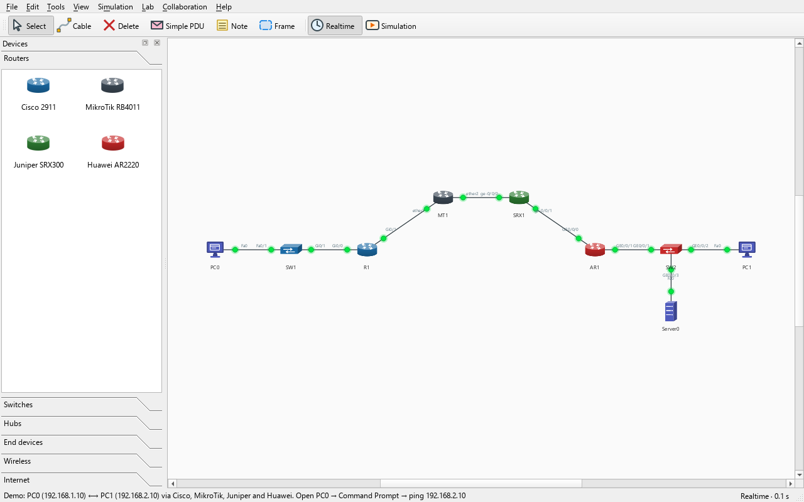
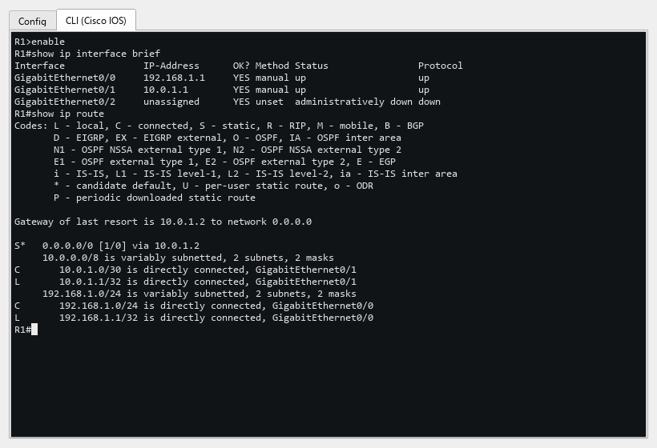
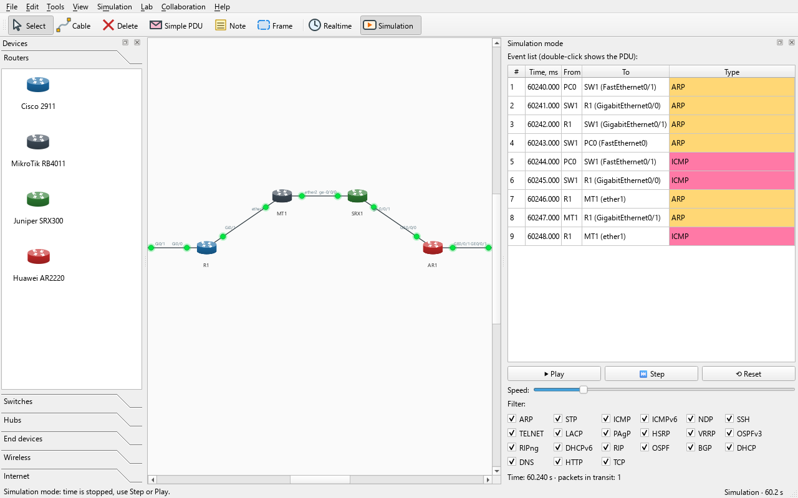
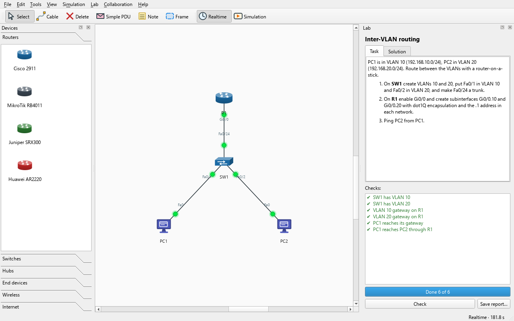
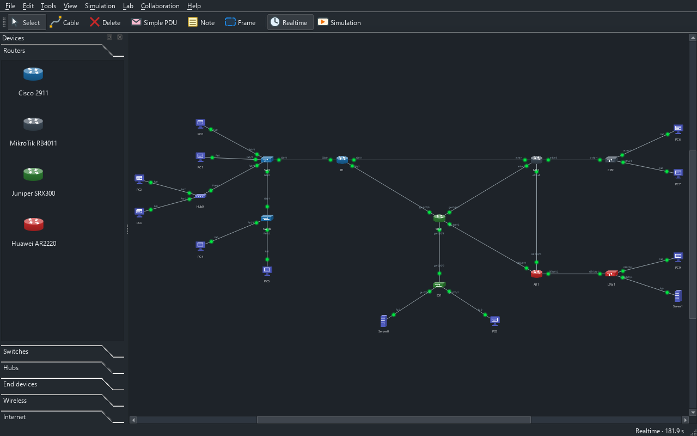

# NetEmu

*Русская версия: [README.ru.md](README.ru.md).*

An educational network simulator in the spirit of Cisco Packet Tracer. Devices from different vendors
are configured through their own CLI: Cisco IOS, MikroTik RouterOS, Juniper Junos, Huawei VRP and
Extreme EXOS, plus Windows and Linux command lines on the end hosts.

Written in Python with PySide6 (Qt). The simulation core has no Qt dependency. Builds for Windows,
Linux and macOS come from the same `netemu.spec` (GitHub Actions builds all three).



| Cisco IOS CLI | Simulation mode |
|---|---|
|  |  |

| Lab with automatic checks (teacher mode) | Dark theme |
|---|---|
|  |  |

## Features

- **New in 0.3**:
  - teaching:
    - 12 ready-made labs with automatic checks: VLAN, inter-VLAN routing, STP, OSPF, DHCP, NAT, ACL, HSRP,
      IPv6, Wi-Fi and two troubleshooting tasks;
    - teacher mode: the solution is encrypted in the file with a password; "apply the solution";
      random fault injection; HTML student report;
  - networking:
    - GRE and IPsec tunnels across the Internet cloud;
    - QoS (classes, DSCP, policing);
    - NAT64;
    - OSPFv3 with an LSA database and areas;
    - Syslog, SNMP v2c and NTP;
    - IP phones with voice VLAN, Cisco CME and RTP;
    - `interface range` in Cisco IOS;
  - interface and distribution:
    - dark theme and interface scale up to 200 %;
    - LAN collaboration on one project;
    - Windows installer.
- **New in 0.2**:
  - Internet cloud with public DNS and web sites;
  - EtherChannel/LACP;
  - HSRP and VRRP;
  - OSPFv3, RIPng and DHCPv6;
  - port security and DHCP snooping;
  - Wi-Fi (access point, laptops, WPA2);
  - undo/redo on the canvas;
  - notes and frames;
  - PNG/SVG export.
- **Canvas**:
  - drag devices from the palette;
  - cables with port selection;
  - zoom (mouse wheel) and pan (middle button);
  - port indicators: green means the link is up, red means it is down.
- **Devices**:

  | Type | Models |
  |---|---|
  | Routers | Cisco 2911, MikroTik RB4011, Juniper SRX300, Huawei AR2220 |
  | Switches (L2 and L3) | Cisco 2960-24TT, MikroTik CRS326, Juniper EX2300, Huawei S5720, Extreme X440-G2 |
  | End devices | PC and server (Windows), PC (Linux), server (Linux), IP Phone 7960 |
  | Wireless | Access point, laptops (Windows, Linux) |
  | Other | Hub, Internet (ISP cloud) |

- **Networking**:
  - L2: Ethernet, MAC learning with aging, 802.1Q VLANs (access, trunk, native VLAN, router-on-a-stick),
    STP (Cisco PVST, RSTP/MSTP elsewhere), EtherChannel/LACP;
  - addressing: ARP with proxy ARP, IPv4, IPv6 (link-local, NDP, RA/SLAAC, DHCPv6);
  - routing:
    - static (longest prefix match, recursive next hop, administrative distance, floating routes);
    - OSPFv2 (DR/BDR, multiple areas, `O IA`/`O E2`, ECMP, redistribution), OSPFv3, RIPv2/RIPng;
    - BGP-4 (eBGP/iBGP, route reflector, best-path selection), HSRP/VRRP;
    - routing on switches (SVI, Vlanif, irb);
  - security: ACLs and firewall filters, NAT (static, pool, PAT, port forwarding), NAT64, port security,
    DHCP snooping;
  - tunnels and QoS: GRE and IPsec, QoS (Cisco MQC, Huawei traffic policy);
  - services: DHCP (server, relay, APIPA), DNS, HTTP (web server and browser), Telnet and SSH between
    devices, Syslog, SNMP v2c (an agent on every device; `snmpget`/`snmpwalk`/`snmpset` on Linux), NTP;
  - IP telephony: voice VLAN, DHCP option 150, Cisco CME, SCCP, RTP marked DSCP EF;
  - ICMP: echo, unreachable, time exceeded; ping and traceroute.
- **CLI**:
  - abbreviations, `?` help, Tab completion, history, Ctrl+C/Ctrl+Z, multi-line paste;
  - the full command list of every vendor is in [docs](docs/README.md).
- **Simulation mode**:
  - step through events or play them at any speed;
  - envelopes animated on the cables, one colour per protocol;
  - event list with a protocol filter;
  - PDU details layer by layer.
- **Labs**:
  - a project file can carry a task, checks (`ping`, `noping`, `route`, `ospf`, `vlan`, `stproot`, `fhrp`,
    `wifi`, …), a hidden solution script and the student attempts;
  - `F6` checks the network;
  - **Lab → Ready-made labs** opens the built-in set.
- **Collaboration**:
  - one copy hosts a session and the others join with its address and a PIN;
  - devices, cables, configurations, notes and the lab are shared;
  - each participant simulates locally.
- **Interface**:
  - Russian or English (**View → Language**);
  - light/dark theme;
  - scale 100–200 % for projectors;
  - built-in help (`F1`).

## Running from source

```bash
python -m venv .venv
.venv/Scripts/pip install -e .[dev]        # Linux/macOS: .venv/bin/pip
.venv/Scripts/python -m netemu             # empty project
.venv/Scripts/python -m netemu examples/multivendor-demo.netemu
```

## Tests

```bash
python -m pytest
```

332 tests cover:
- the core (switching, VLAN, STP, routing protocols, NAT/ACL, QoS, tunnels, services, VoIP, IPv6, save/load);
- the CLI of every vendor;
- that every ready-made lab can be solved;
- teacher mode and collaboration;
- the GUI (pytest-qt, off screen with `QT_QPA_PLATFORM=offscreen`).

Other tools:
- `python tools/make_labs.py` rebuilds and re-verifies the ready-made labs;
- `python tools/screenshots.py` re-renders these screenshots;
- `python tools/gen_docs.py` regenerates the command tables in the docs.

## Building

```bash
python tools/build.py
```

The script renders the icon and the command reference, builds the program with PyInstaller and
packs it into `release/`:

| OS | Result |
|---|---|
| Windows | `NetEmu-<version>-windows-x64.zip` and `NetEmu-<version>-setup.exe` (needs [Inno Setup 6](https://jrsoftware.org/isinfo.php)) |
| Linux | `NetEmu-<version>-linux-x86_64.tar.gz` |
| macOS | `NetEmu-<version>-macos.zip` with `NetEmu.app` |

GitHub Actions (`.github/workflows/build.yml`) runs the whole test suite on Windows, Ubuntu and
macOS for every push and pull request. Tags `v*` and manual runs of the workflow build all three
packages.

## Code layout

```
netemu/core/          simulation core, no Qt
  engine.py           discrete-event engine (virtual time, ms)
  devices/            hub, switch, hosts, router, access point, IP phone, Internet cloud, model catalogue
  stack/              ARP, IPv4/ICMP, IPv6/ICMPv6, ping and traceroute
  routing/            OSPF, OSPFv3, RIP/RIPng, BGP, HSRP/VRRP
  services/           DHCP, DHCPv6, DNS, HTTP, Telnet/SSH, Syslog/SNMP/NTP
  security/           ACL, NAT, NAT64, QoS
  cli/                command-tree parser and the vendor dialects
  tunnel.py           GRE and IPsec
  lab.py              labs, checks, teacher mode, faults, reports
  collab.py           collaboration: project snapshots and sync operations
netemu/gui/           PySide6 user interface
netemu/resources/labs ready-made labs
docs/en, docs/ru      documentation (command tables generated from the CLI)
tests/                pytest + pytest-qt
```

## Limitations

- NAT64 translates ICMP echo only.
- HSRP is Cisco only; VRRP is available everywhere.
- QoS is configured on Cisco and Huawei only.
- IPsec is available on Cisco and MikroTik; GRE on all routers.
- Voice VLAN works on Cisco, Huawei and Juniper switches; CME is Cisco only.
- One IPv4 address per interface.
- STP is computed per switch domain without max-age timers.
- In a collaboration session every participant runs their own simulation.
- Linux and macOS builds are verified by CI only.
